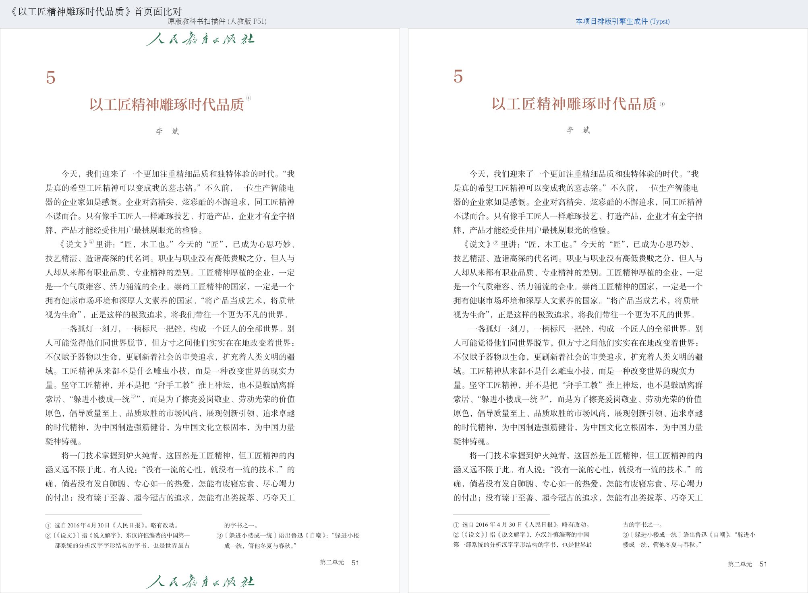
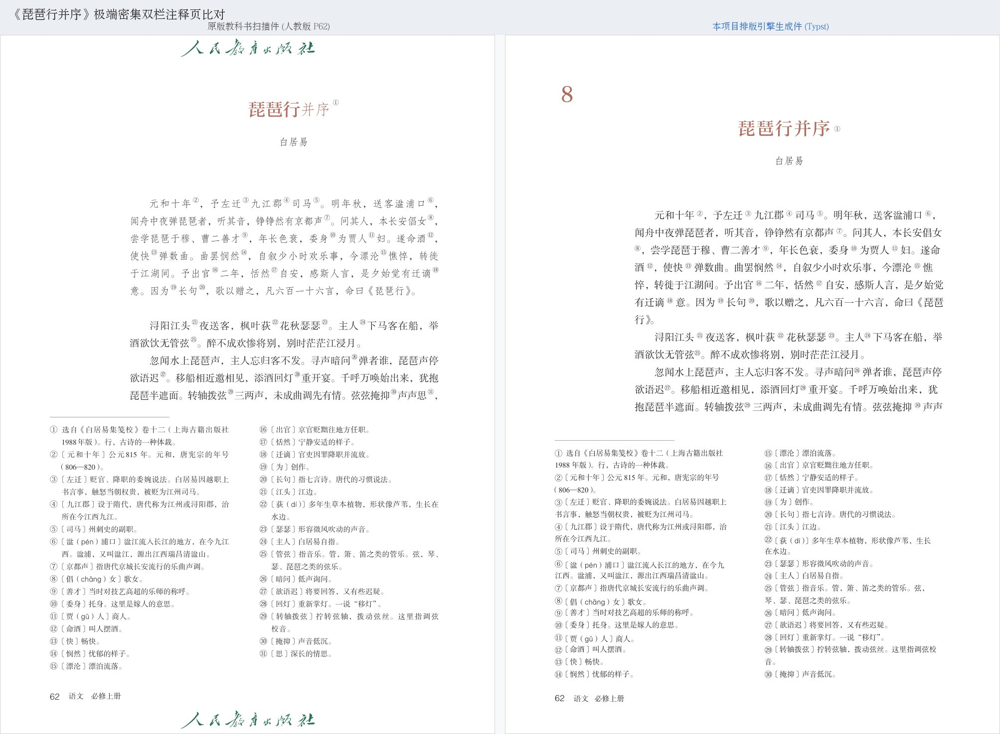
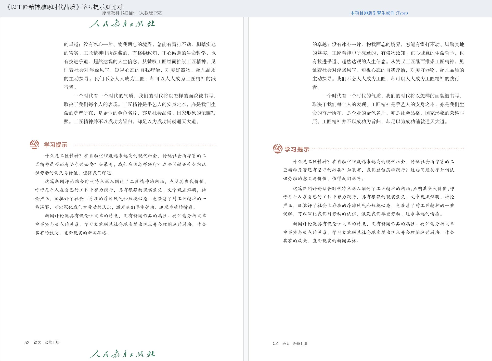

# 统编高中语文教科书高仿排版引擎 (Textbook Typesetter)

基于现代出版级排版编译器 **Typst** 与 Python CJK 几何版心调度引擎构建，像素级复刻中国教育部统编高中语文教科书（人教版必修/选择性必修）印刷出版标准。

> [!IMPORTANT]
> **运行前必读（字库与依赖配置说明）**：
> 因商业字库知识产权保护，本代码仓库**未打包附带商用中文字库文件与 Typst 编译器二进制**。若直接在缺失字体的环境下运行，Typst 的字体回退（Fallback）机制将导致 31 字网格对齐失效、拼音声调丢失或排版几何偏差。
>
> 完整所需 8 种字体清单、命名规范、Typst 编译器与 Python 依赖安装方法，请务必先查阅 👉 **[依赖与字库配置指南 (requirements.md)](requirements.md)**。

---

## 快速使用 (Quick Start)

配置好 [requirements.md](requirements.md) 中的字库与依赖后，即可在命令行一键排版：

### 1. 命令行调用

```bash
python textbook_typesetter.py <输入课文.md> [选项]
```

#### 典型范例

- **基本排版（自动生成同名 PDF）**：
  ```bash
  python textbook_typesetter.py gongjiang_article.md
  ```
- **指定起始页码、页脚单元与书名，并导出高清预览图**：
  ```bash
  python textbook_typesetter.py gongjiang_article.md -o output_gongjiang.pdf -p 51 -u "第二单元" -b "必修上册" --preview
  ```
- **排版极端密集注释课文（如《琵琶行》）**：
  ```bash
  python textbook_typesetter.py pipaxing_article.md -o output_pipaxing.pdf -p 62 -u "第三单元" -b "必修上册" --preview
  ```

#### CLI 参数说明

| 参数 | 全称 | 说明 | 缺省值 / 优先级 |
| :--- | :--- | :--- | :--- |
| `input` | （位置参数） | 输入的 Markdown 课文文件路径 | **必填** |
| `-o` | `--output` | 输出的 PDF 文件路径 | 默认为 `output_<文件名>.pdf` |
| `-p` | `--start-page` | 起始页码（奇数则为奇数页排版，偶数则为偶数页排版） | CLI > Frontmatter > 缺省 `1` |
| `-b` | `--book-title` | 偶数页页脚书册名称（如“必修上册”、“选择性必修中册”） | CLI > Frontmatter > 缺省 `"必修上册"` |
| `-u` | `--unit` | 奇数页页脚单元名称（如“第一单元”、“第二单元”） | CLI > Frontmatter > 缺省 `""` |
| `--preview` | | 是否自动将每页渲染为 150DPI PNG 预览图 | 默认不开启 |
| `--font-path`| | 字体库目录路径 | 默认为 `./fonts` |

---

### 2. Markdown 课文编写规范

输入文档无需死板套用特定标题层级或手打繁琐的括号符号。支持灵活的章节标题（如 `### 正文`、`## 课文正文`、`### 【课文正文】`，甚至在 Frontmatter 后直接写正文），**注释部分直接采用词典格式编写，程序自动补全 `〔〕`**：

```markdown
---
title: 以工匠精神雕琢时代品质
author: 李斌
lesson_num: 5
unit: 第二单元
book_title: 必修上册
start_page: 51
---

### 正文

今天，我们迎来了一个更加注重精细品质和独特体验的时代……企业才有金字招牌。

《说文》②里讲：“匠，木工也。”……也不是鼓励离群索居、“躲进小楼成一统③”……同时注释角标也支持方括号[4]。

### 注释

```yaml
1: 选自2016年4月30日《人民日报》。略有改动。
2: {《说文》: 指《说文解字》，东汉许慎编著的中国第一部系统的分析汉字字形结构的字书，也是世界最古的字书之一。}
3: {躲进小楼成一统: 语出鲁迅《自嘲》：“躲进小楼成一统，管他冬夏与春秋。”}
4: {词条名: 释义内容，无需手动输入“〔”与“〕”。}
```

### 学习提示

什么是工匠精神？在自动化程度越来越高的现代社会……
```

#### 编写要点：
1. **词典格式注释（免手打符号）**：
   - 在 `### 注释`（或 `### 【课文字词与出处注释】`）下使用 YAML 词典（支持带或不带 ```` ```yaml ```` 代码块围栏，也支持直接写在 Frontmatter 的 `footnotes:` 字段中）。
   - **普通字符串**（如 `1: 选自...`）：原样输出，适用于课文出处与背景简介。
   - **嵌套词典**（如 `2: {词条: 释义}`）：程序自动将键名用 `〔` 和 `〕` 包裹并紧接释义（输出 `〔词条〕释义`），彻底免去手动输入 `〔〕` 的繁琐。
2. **正文角标**：
   - 支持全局连续带圈字符 `①②③...` 或方括号数字 `[1][2]...`；引擎分页时会自动按页重编为从 ①（1）起始的局部序号。
3. **灵活章节识别**：
   - 正文（`正文` / `课文正文` / 省略标题直接撰写）、注释（`注释` / `字词注释` / `课文字词与出处注释`）、学习提示（`学习提示`）均支持任意 `#` 级标题且不强制要求 `【】` 或 `---` 分割线。

---

## 排版效果与原版教材比对 (Side-by-Side Comparisons)

以下比对图均采用自动化审查工具按统一比例并排生成，左侧为官方原版教科书高清扫描件（人教版），右侧为本项目 Typst 引擎排版生成件：

### 1. 《以工匠精神雕琢时代品质》首页面比对（奇数页起始，正文 24 行 + 3 条双栏注释）
> 正文网格 1:1 精确对齐，标题/作者署名/正文起点绝对坐标精确落位；双栏注释左右严格对半平衡（左 3 行，右 3 行），底端与页脚保持安全间距。



---

### 2. 《琵琶行并序》极端密集双栏注释页比对（偶数页起始，正文 12 行 + 30 条密集注释）
> 攻克“密集注释导致正文与注释博弈振荡”的业界难题。正文所引注释全部在当页闭环消化，左右栏各 19 行绝对等分平衡，底端基线对齐至 `775.36pt`，绝不下溢侵入页脚。



---

### 3. 《以工匠精神雕琢时代品质》末页【学习提示】比对（正文 10 行 + 三段式学习提示）
> 自适应判别尾页内容承载量，正文下方精确留白，官方折带三角矢量徽标、圆形点阵虚线分割线、楷体首行缩进 2 字符完美还原。



---

## 核心架构与特性

- **出版级 CJK 版心网格**：
  - 正文严格遵循每行 31 个全角字格（字号 12.0pt，栏宽 372.0pt，单行行距 21.0pt）。
  - 内置严格的避头尾禁则（行首禁止收尾标点、行末禁止开门标点）与连续标点挤压对齐。
- **原子捆绑单调贪心分页算法（零跨页顺延）**：
  - 正文行与当行所引注释强原子捆绑，在 728.0pt 版心极限容量下贪心收敛。
  - **当页所引注释必须在当页闭环**，彻底杜绝传统排版引擎中“注释跨页顺延”或“注释与正文震荡重叠”的缺陷。
- **物理分行双栏注释平衡对等（方案一）**：
  - 注释单栏宽 215.6pt，单行行距 14.8pt，栏间距 36.8pt。
  - Python 端在排版前将每条注释预切为物理行（内置西文单词与连续数字原子保护），并将全页总行数严格等分为左栏 $\lceil M/2 \rceil$ 行与右栏 $\lfloor M/2 \rfloor$ 行，左右底端基线绝对齐平（`y1 = 775.36pt`），与页脚保有充裕安全留白。
- **每页独立从 1 编号**：
  - 自动识别正文角标与注释项，在分页后按页独立从 ①（1）重新起编，正文角标与页底注释完美映射。
- **奇偶页镜像版心与页脚**：
  - 奇数页：正文靠左（左边距 67.3pt，右边距 156.0pt），页脚在右下角（`[单元名称] + 11pt + [页码]`）。
  - 偶数页：正文靠右（左边距 156.0pt，右边距 67.3pt），页脚在左下角（`[页码] + 11pt + 语文 + 7pt + [书册名称]`）。
  - 注释与学习提示不受奇偶边距影响，始终保持规范统一边距。
- **正规字库严格隔离**：
  - 汉字正文/注释：方正书宋（`FZSSK.TTF`）
  - 课文标题：方正准雅宋（`FZZHUNYSK.TTF`）
  - 作者署名：方正仿宋（`FZFSK.TTF`）
  - 学习提示：方正楷体（`FZKTK.TTF`）+ 兰亭黑徽标标题（`FZLanTingHei-R-GBK.ttf`）
  - 注释拼音：注释专用拼音字库（`neu-xt.ttf`）
  - 注释数字：系统自带西文字体 `Times New Roman`
  - 带圈序号：专业序号字库（`rope_sequence_number_st_r.ttf`，覆盖 1~99）
  - 页码数字：等线体（`Dengxian.ttf`）

---

## 机械审查与比对验证

本工具包配套提供自动化审查脚本 `image_diff_inspector.py`，可对待测 PDF 与官方原版教材进行结构化比对：

```bash
# 对比《工匠精神》生成结果与教材原版 P51~P52
python image_diff_inspector.py -t output_gongjiang.pdf -r example.pdf --target-pages 0 1 --ref-pages 2 3
```

审查项涵盖：
- **行数精准度**：严格核验正文行数是否与原教材标杆（如 P51: 24行）一致。
- **重叠检测 (Overlap Check)**：检测正文文字、分割线、注释之间是否存在 y 轴碰撞或安全间距违规。
- **图像结构相似度 (SSIM) 与峰值信噪比 (PSNR)**：生成差异热力图与审查报告。
